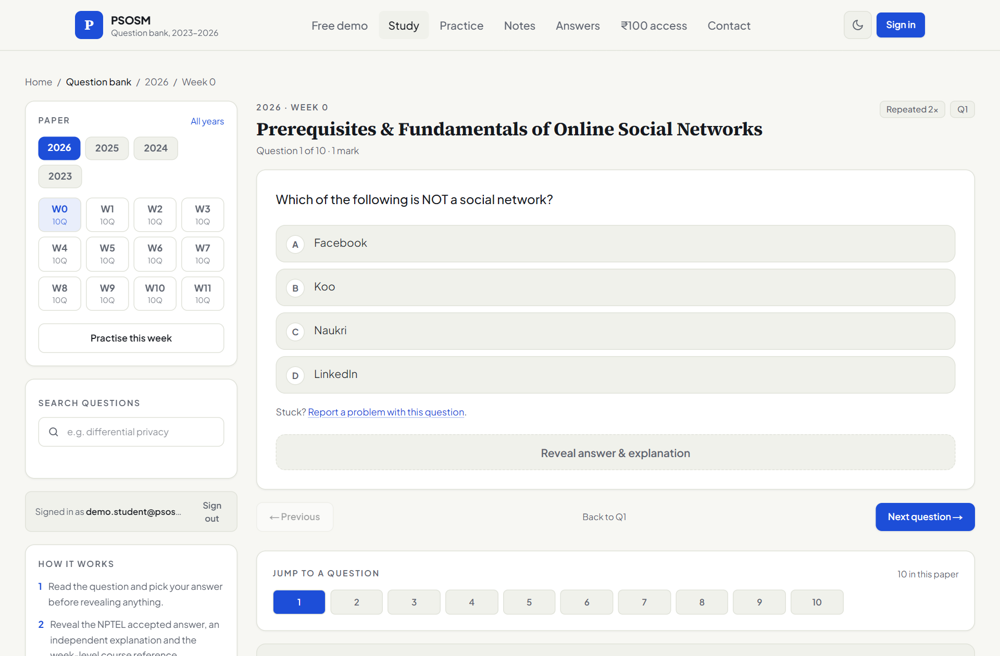
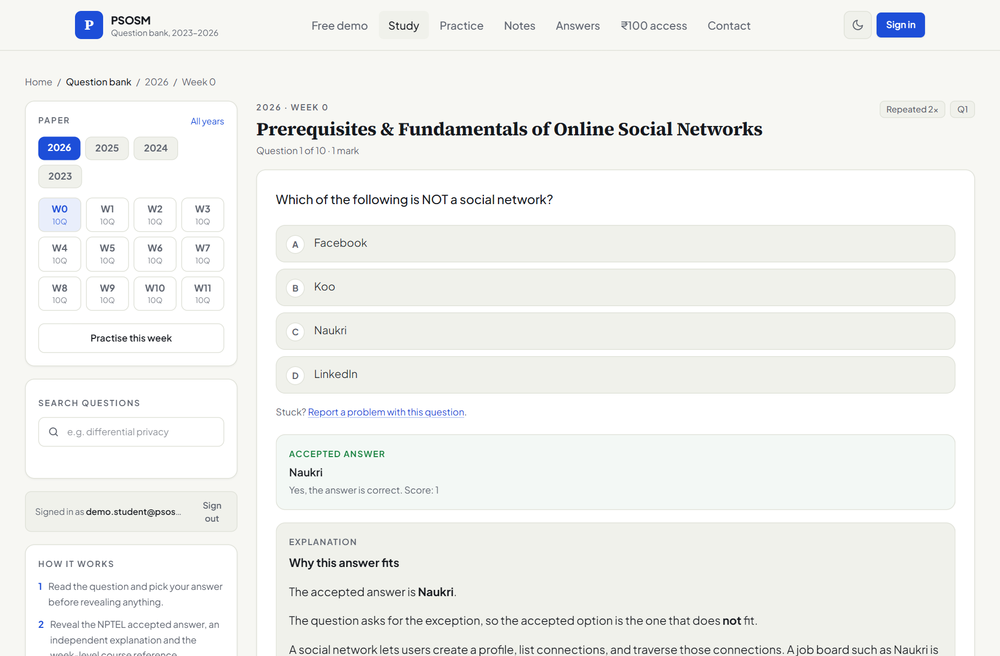
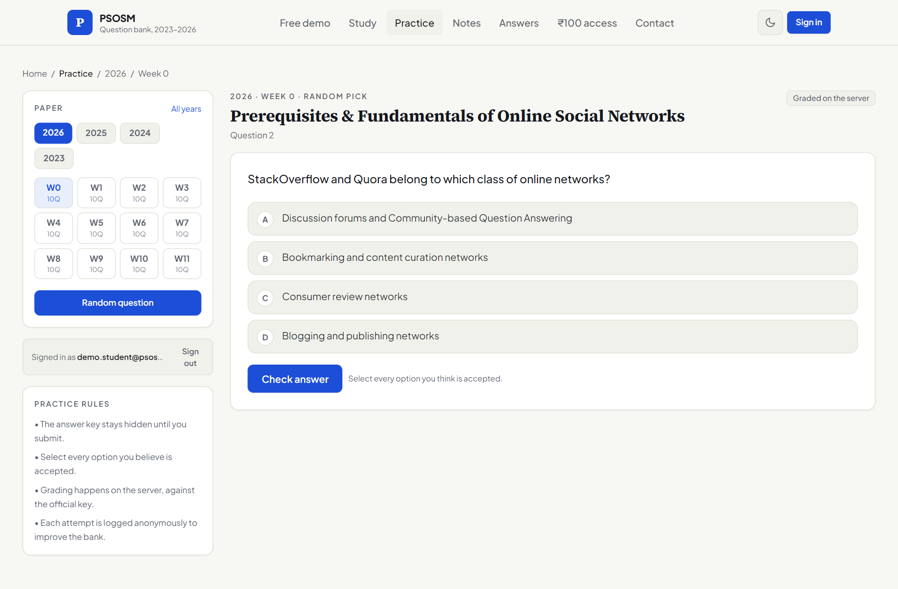
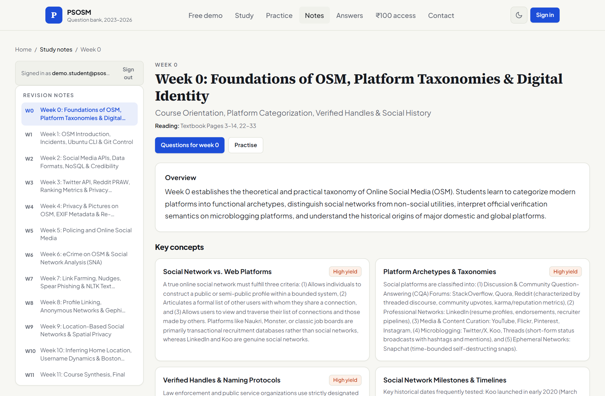
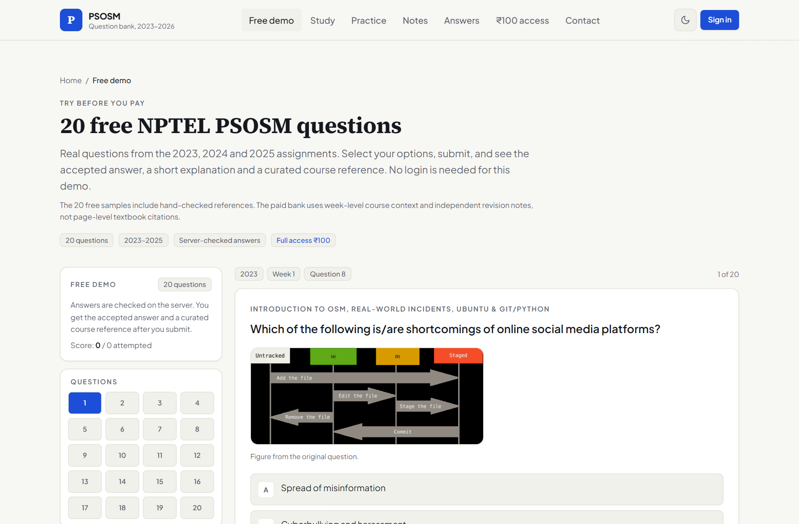
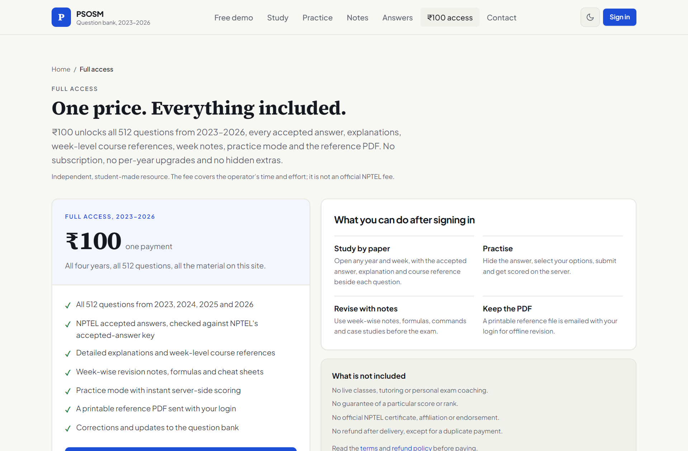
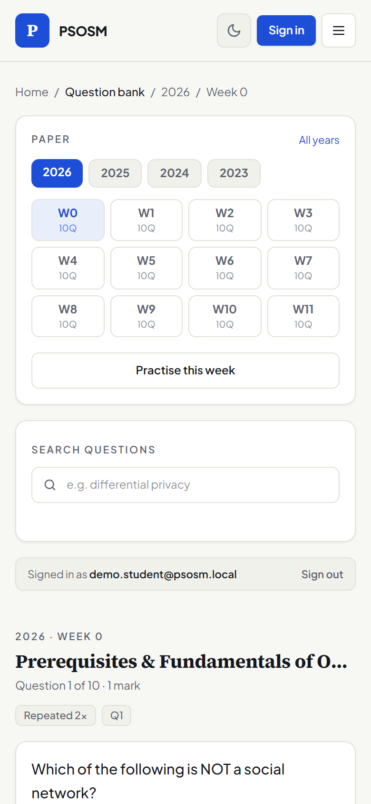
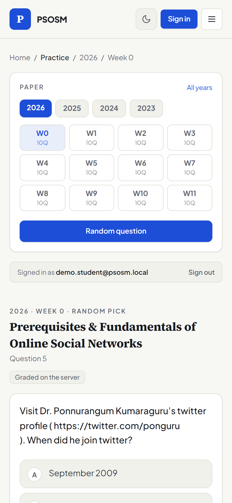
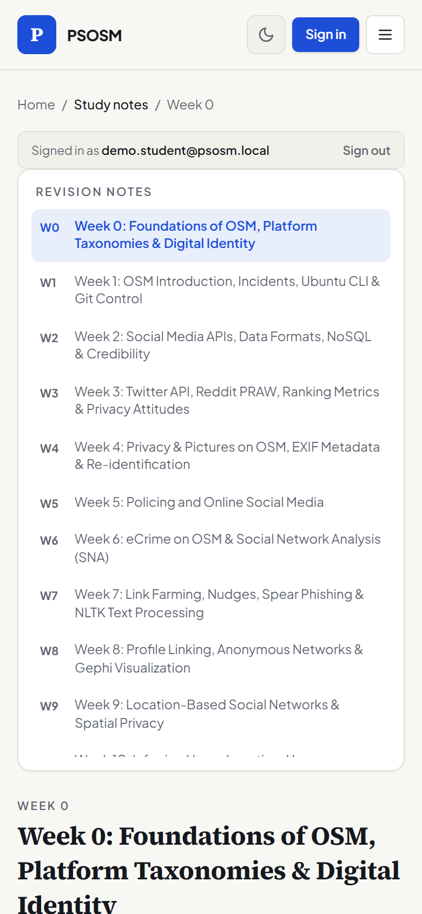
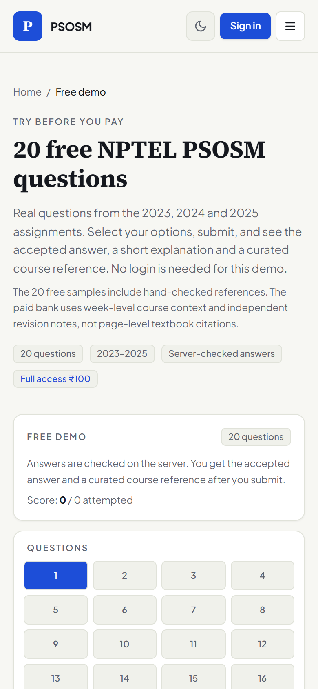

# NPTEL PSOSM — Previous Year Questions, Solved Practice & Study Notes (2023–2026)

> **Interactive Revision Portal & Solved Question Bank for NPTEL / SWAYAM: Privacy and Security in Online Social Media** (`noc26-cs69`), taught by **Prof. Ponnurangam Kumaraguru (PK)**, IIIT Delhi / IIT Madras.

---

## 📌 Disclaimer & Honest Course Attribution

**This is an independent, student-created revision and indexing resource.** It is **not** affiliated with, endorsed by, sponsored by, approved by, or connected to NPTEL, SWAYAM, IIT Madras, IIIT Delhi, or any government body.

* The terms "NPTEL", "SWAYAM", and "PSOSM" are used strictly to identify the educational curriculum and course syllabus.
* This repository serves as an indexing and advertising reference containing curated public samples, documentation, and screenshots.
* **For full platform access, complete question banks, interactive practice tools, and revision modules, please refer to the website: [https://nptel-psosm.vercel.app](https://nptel-psosm.vercel.app)**.

---

## 🌟 What is the NPTEL PSOSM Study Portal?

The [NPTEL PSOSM Study Portal](https://nptel-psosm.vercel.app/) is a dedicated revision environment built for students taking the *Privacy and Security in Online Social Media* course. It consolidates four full years of assignment papers into a structured, high-performance web application:

- **512 Machine-Audited Assignment Questions (2023–2026)**: Questions mapped across all 12 weeks of the curriculum with verified accepted answers.
- **Conceptual Explanations & Course Context**: In-depth explanations covering core concepts—k-anonymity, differential privacy, sybil defenses, link farming, sentiment analysis, LIWC, OAuth, and API data collection.
- **12 Weeks of High-Yield Revision Notes**: Comprehensive weekly summaries (Week 0 through Week 11), key formulas, command cheat sheets, and exam patterns.
- **Interactive Practice Exam Mode**: Instant server-side grading, option shuffling, and detailed question explanations.
- **Searchable Offline Reference Companion**: High-density revision guide for comprehensive exam preparation.
- **Fully Responsive Architecture**: Optimized for seamless studying on mobile devices, tablets, and desktop workstations.

---

## 📱 Platform Showcase & Interface Previews

### Desktop Interface

| 📖 Study Mode (Question & Options) | 💡 Detailed Solution & Course Context |
| :---: | :---: |
|  |  |

| ✍️ Practice Mode & Instant Grading | 📑 Weekly Structured Revision Notes |
| :---: | :---: |
|  |  |

| 🎯 Public Demo (20 Samples) | 🌐 Platform Information & Overview |
| :---: | :---: |
|  |  |

---

### Mobile Responsive Experience

The entire portal is engineered with a mobile-first design, ensuring an intuitive study experience on any smartphone or tablet:

| Study View | Practice Exam | Revision Notes | Free Demo |
| :---: | :---: | :---: | :---: |
|  |  |  |  |

---

## 🆓 Free Public Samples (20 Solved Questions)

To evaluate the quality of the curated solutions and explanations, 20 real sample questions are provided directly in this repository and interactively online:

🌐 **Interactive Public Demo**: [https://nptel-psosm.vercel.app/samples](https://nptel-psosm.vercel.app/samples)

### Curated Samples Directory ([`Samples/`](Samples/)):

| Year | Week | Question | Topic | Accepted Answer | File |
| :--- | :--- | :--- | :--- | :--- | :--- |
| **2023** | Week 1 | Q8 | OSM Incidents & Privacy Risks | Multi-select risks | [2023-week-01-q8.md](Samples/2023-week-01-q8.md) |
| **2023** | Week 3 | Q2 | Twitter Metadata & Graph Structure | Tweet link & author metadata | [2023-week-03-q2.md](Samples/2023-week-03-q2.md) |
| **2023** | Week 4 | Q9 | k-Anonymity & Linking Attacks | Re-identification prevention | [2023-week-04-q9.md](Samples/2023-week-04-q9.md) |
| **2023** | Week 5 | Q5 | Sentiment Analysis & Text Tools | Linguistic Inquiry & Word Count (LIWC) | [2023-week-05-q5.md](Samples/2023-week-05-q5.md) |
| **2024** | Week 1 | Q1 | Anonymous Social Networks | Whisper, Sarahah | [2024-week-01-q1.md](Samples/2024-week-01-q1.md) |
| **2024** | Week 1 | Q14 | Version Control Basics | Untracked Files | [2024-week-01-q14.md](Samples/2024-week-01-q14.md) |
| **2024** | Week 2 | Q3 | Web APIs & Data Formats | JSON interchange format | [2024-week-02-q3.md](Samples/2024-week-02-q3.md) |
| **2024** | Week 3 | Q2 | Misinformation & Flair NLP | Flair library | [2024-week-03-q2.md](Samples/2024-week-03-q2.md) |
| **2024** | Week 3 | Q17 | NoSQL Databases & MongoDB | Document-oriented storage | [2024-week-03-q17.md](Samples/2024-week-03-q17.md) |
| **2024** | Week 4 | Q2 | Self-Disclosure & Privacy Boundaries | Public self-disclosure risks | [2024-week-04-q2.md](Samples/2024-week-04-q2.md) |
| **2024** | Week 9 | Q4 | Location-Based Social Networks | Foursquare check-in dynamics | [2024-week-09-q4.md](Samples/2024-week-09-q4.md) |
| **2025** | Week 1 | Q3 | Big Data 4 V's Framework | Veracity & data integrity | [2025-week-01-q3.md](Samples/2025-week-01-q3.md) |
| **2025** | Week 2 | Q2 | Serialization Formats | JavaScript Object Notation | [2025-week-02-q2.md](Samples/2025-week-02-q2.md) |
| **2025** | Week 3 | Q7 | Twitter OAuth & API Keys | Bearer tokens & client credentials | [2025-week-03-q7.md](Samples/2025-week-03-q7.md) |
| **2025** | Week 4 | Q2 | Privacy Taxonomy & Dimensions | Bodily, territorial, information privacy | [2025-week-04-q2.md](Samples/2025-week-04-q2.md) |
| **2025** | Week 6 | Q3 | e-Crime & Social Engineering | Whaling / executive spear phishing | [2025-week-06-q3.md](Samples/2025-week-06-q3.md) |
| **2025** | Week 7 | Q9 | Link Farming & Spam Networks | Syntactic link injection attacks | [2025-week-07-q9.md](Samples/2025-week-07-q9.md) |
| **2025** | Week 9 | Q1 | Spatial & Geo-location Services | Foursquare, Yelp, Uber, Ola | [2025-week-09-q1.md](Samples/2025-week-09-q1.md) |
| **2025** | Week 10 | Q12 | Crisis Informatics & Fact-Checking | Boston Marathon incident timeline | [2025-week-10-q12.md](Samples/2025-week-10-q12.md) |
| **2025** | Week 11 | Q7 | Final Exam Synthesis & Recap | Comprehensive concepts recap | [2025-week-11-q7.md](Samples/2025-week-11-q7.md) |

---

## 📚 Week-by-Week Course Syllabus & Exam Topics

| Week | Core Focus Areas | Key Keywords & Concepts |
| :---: | :--- | :--- |
| **Week 1** | Introduction to Online Social Media (OSM) & Incident Case Studies | Anonymous networks (Whisper, Sarahah), Ubuntu CLI, Git version control, Python basics, Big Data 4 V's (Veracity, Volume, Velocity, Variety). |
| **Week 2** | Social Media APIs, Data Collection & Trust | Reddit API, PRAW, Facebook Graph API, JSON data serialization, user credibility, platform trust metrics. |
| **Week 3** | Misinformation, NLP & Social Graph Data | Fake news propagation, Flair NLP, Twitter API v2 endpoints, MongoDB document stores, SQL queries. |
| **Week 4** | Privacy, Pictures & Anonymity on OSM | k-Anonymity, l-diversity, t-closeness, linking attacks, Exif image metadata, self-disclosure boundaries. |
| **Week 5** | Policing Social Media & Sentiment Analysis | Sentiment classification, VADER sentiment analyzer, LIWC (Linguistic Inquiry and Word Count), psycholinguistic markers. |
| **Week 6** | eCrime, Social Engineering & SNA | Phishing attacks, spear phishing, executive whaling, fraud networks, Social Network Analysis (SNA), centrality metrics. |
| **Week 7** | Link Farming, Spam Networks & Text Processing | Sybil attacks, spamdexing, search rank manipulation, link farms, privacy nudges, NLTK tokenization & stopword removal. |
| **Week 8** | Geospatial Privacy & Mobility Data | Location-Based Social Networks (LBSN), check-in frequency, spatial entropy, GPS tracking privacy risks. |
| **Week 9** | Spatial Privacy, Visualization & Mobility | Highcharts data visualization, Foursquare check-in dynamics, Yelp, Uber/Ola spatial data analysis. |
| **Week 10** | Home Location Inference & Crisis Informatics | Username change dynamics, inferring user location without GPS, Boston Marathon misinformation timeline, crowd-sourced fact-checking. |
| **Week 11** | Course Synthesis, Exam Preparation & Policies | Comprehensive recap, multi-concept questions, privacy policy analysis, SWAYAM final exam pattern analysis. |

---

## ❓ Frequently Asked Questions (FAQ) for Exam Revision

<strong>Q1: What is the NPTEL PSOSM course and who teaches it?</strong>

*Privacy and Security in Online Social Media* (Course Code: `noc26-cs69`) is an NPTEL/SWAYAM computer science course taught by **Prof. Ponnurangam Kumaraguru (PK)**, faculty at IIIT Delhi and IIT Madras. It covers online privacy, security challenges, misinformation detection, eCrime, social network APIs, and data ethics.

<strong>Q2: Where can I find verified NPTEL PSOSM previous year assignment questions?</strong>

The live study portal at **[https://nptel-psosm.vercel.app](https://nptel-psosm.vercel.app)** archives all 512 machine-audited questions across 2023, 2024, 2025, and 2026. A 20-question public demo is freely accessible at [https://nptel-psosm.vercel.app/samples](https://nptel-psosm.vercel.app/samples) and in the [`Samples/`](Samples/) folder of this repository.

<strong>Q3: How are the assignment questions and answers verified?</strong>

Every single question is audited directly against the official NPTEL accepted answers published after assignment submission deadlines. 100% of single-choice, multiple-correct (multi-select), and numerical answers are programmatically verified with 0 unmatched questions.

<strong>Q4: How should I prepare for the NPTEL PSOSM proctored final exam?</strong>

Students preparing for the proctored exam should:
1. Practice previous year assignment questions (2023–2026), as exam patterns frequently include repeated and conceptually related questions.
2. Review weekly revision cheat sheets covering formulas, LIWC categories, k-anonymity definitions, and API mechanisms.
3. Take timed mock tests on the [PSOSM portal](https://nptel-psosm.vercel.app) to test accuracy under exam conditions.

---

## 🌐 Full Platform & Access Details

The complete platform features all 512 questions, the interactive self-testing engine, week-level revision cheat sheets, and the offline study companion.

**Please refer to the website for more information, interactive features, and full access:**  
👉 **[https://nptel-psosm.vercel.app](https://nptel-psosm.vercel.app)**

---

## 📬 Contact & Inquiries

For questions, feedback, or further details:
* **Website**: [https://nptel-psosm.vercel.app](https://nptel-psosm.vercel.app)
* **Direct Email**: [nptel.psosm@gmail.com](mailto:nptel.psosm@gmail.com)
